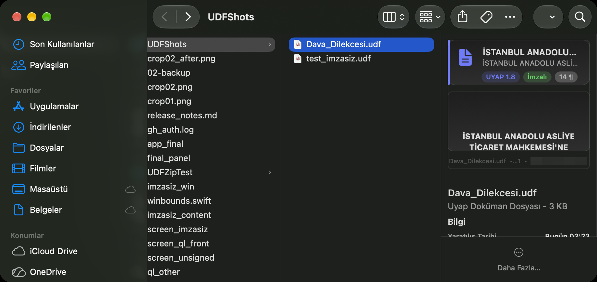
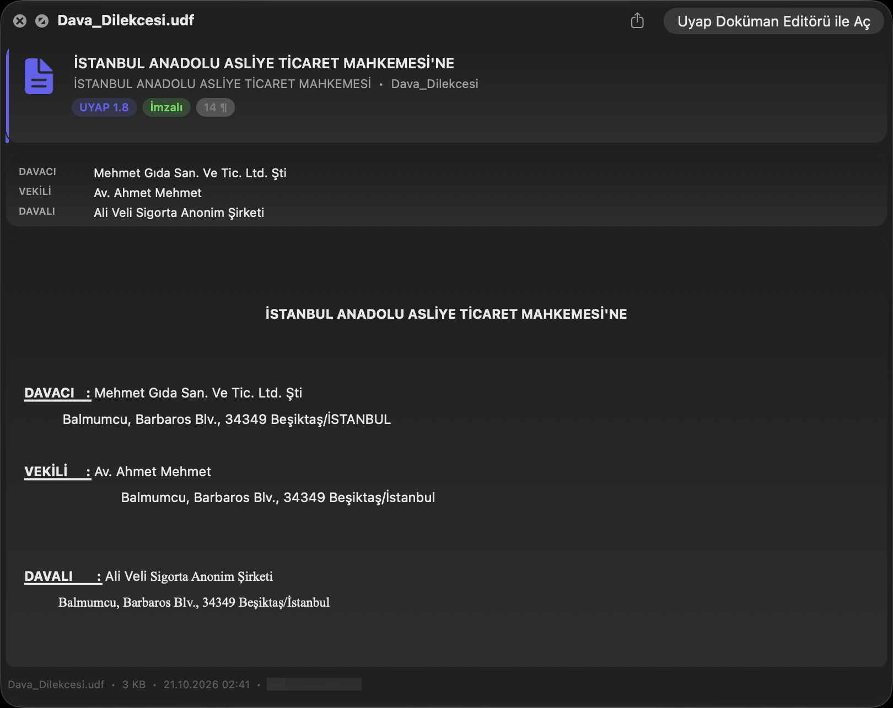
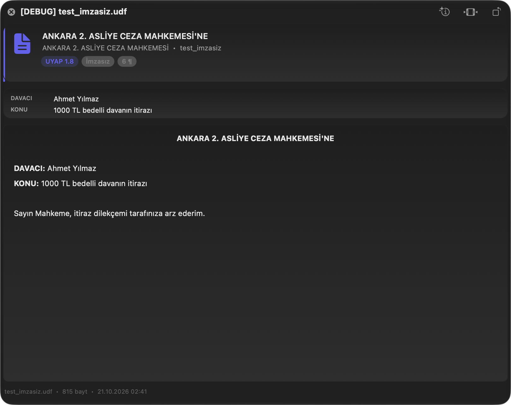

# UYAP UDF Önizleme

macOS Finder'da **UYAP Doküman Editörü** ile üretilen `.udf` belgelerinin önizleme
panelinde (ve <kbd>Space</kbd> ile açılan hızlı önizlemede) okunabilir bir önizleme
gösteren bir **QuickLook Önizleme Eklentisi**.

Önizleme paneli varsayılan olarak yalnızca UDF simgesini ve dosya bilgisini gösterir.
Bu uygulama, belgeyi açmadan şunları gösterir:

|  | İçerik |
|---|---|
| Başlık | Belgenin başlığı, mahkeme adı ve rozetler (UYAP sürümü, **İmzalı/İmzasız**, paragraf sayısı) |
| Özet | DAVACI, VEKİLİ, DAVALI, KONU satırları |
| Belge | `content.xml` içindeki metin, **hizalama/kalın italik/altı çizili/biçim ve yazı tipi bilgileriyle** yeniden oluşturulur (Times New Roman gövde metni dahil) |
| Altbilgi | Dosya adı, boyut, değiştirilme tarihi ve **imza zincirinin kökü** (örn. TÜRKTRUST) ile imza zamanı |

---

## Kurulum

1. `UYAP-UDF-Onizleme.zip` arşvini açın.
2. `UYAP UDF Onizleme.app` paketini **Applications** klasörüne sürükleyin.
3. Uygulamayı **bir kez çift tıklayarak açın**. Uygulama kendi eklentisini macOS'a
   kaydeder ve "Hazır!" penceresini gösterir.
4. Bu penceredeki **Kapat** düğmesine basın.

Artık Finder'da bir `.udf` dosyasını seçtiğinizde önizleme panelinde belge metni görünür.

>Önizleme paneli kapalıysa: **Görüntü ▸ Önizlemeyi Göster**.

---

## Ekran görüntüleri

**Finder önizleme paneli** (dar panelde belge metni kaydırılabilir, özet kartı otomatik gizlenir):

**Hızlı önizleme penceresi** (<kbd>Space</kbd>) — özet kartı ve belgenin tamamı görünür:

**İmzasız belge** durumunda rozet "İmzasız" olarak görünür:

---

## Sınırlar ve notlar

- UYAP Doküman Editörü kurulu değilse önizleme tetiklenmez.
- Önizleme, `content.xml` içindeki **metni** gösterir; UYAP Doküman Editörü'nün
  zengin düzenleme özelliklerini (tablo, ek, imza görseli) kapsamaz.
- `sign.sgn` içindeki imza **doğrulanmaz**; yalnızca imzalayan kişi, imza zincirinin
  kökü ve imza zamanı okunup gösterilir. Hukuki süreçte kullanılacağı zaman doğrulama
  ayrıca yapılmalıdır.
- **BU EKLENTİ TAMAMIYLA YAPAY ZEKA İLE YAZILMIŞTIR**, yayımlanma zamanındaki en güncel macOS sürümü (27.0.1) ile çalıştığı test edilmiştir. Gelecekte güncelleme alacağının herhangi bir garantisi yoktur.
